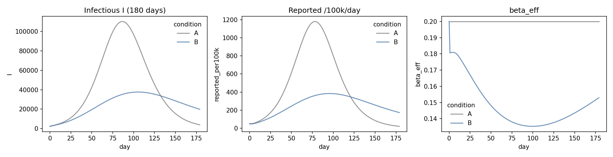
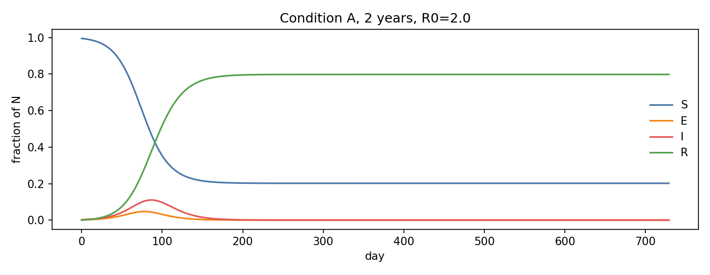
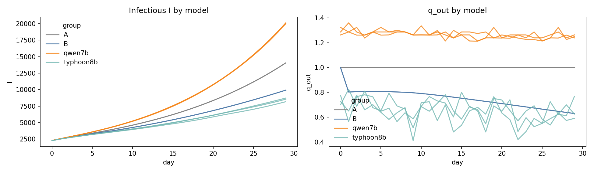
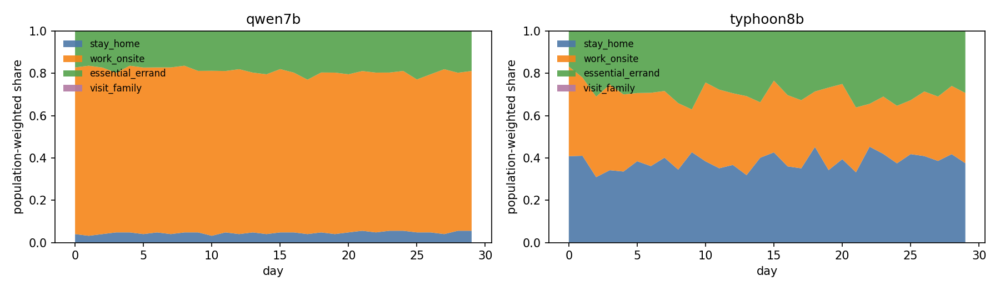
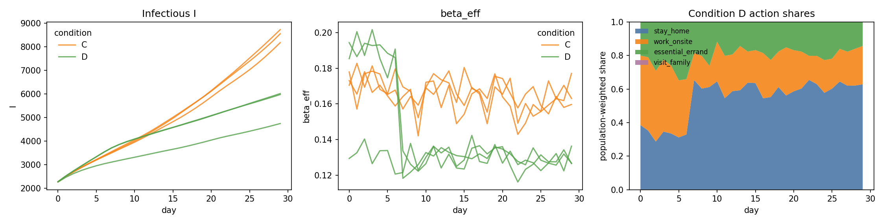
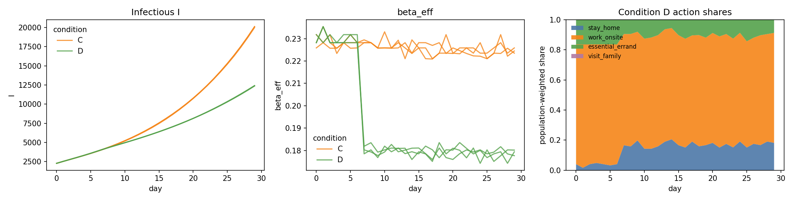

**Generative Agent-Based Modeling (GABM) — oupling เข้ากับ mechanistic SEIR model สำหรับจำลองพฤติกรรมของคนไทยในบริบทวัฒนธรรม/สังคมที่ต่างจากตะวันตก**

**6634468023 นายศิวะกร สายไพศรี**

**Progress Report #1 มีเนื้อหาในส่วนต่อไปนี้**

**ที่มาและความสำคัญ (Background and Motivation / Rationale)**

**งานวิจัยที่ 1: Williams et al. (2023) *Epidemic Modeling with Generative Agents***

1)  **เป็นงานวิจัยเกี่ยวกับอะไร ทำไมถึงเป็นปัญหา (ให้สรุปมา)**

**(Background and Motivation of this research)**

- การสร้างแบบจำลองระดับบุคคล คือ **การใส่พฤติกรรมมนุษย์เข้าไปในแบบจำลองโรคระบาด**

- ผู้เขียนชี้ว่าแม้พฤติกรรมสำคัญ แต่ modeler ส่วนใหญ่ยังไม่จัดการเรื่องนี้อย่างครอบคลุม งานที่ ground กับข้อมูลจริงมักป้อนข้อมูลพฤติกรรมแบบ exogenous เช่น mobility/seasonality time series มีเพียงส่วนน้อยที่ formulate พฤติกรรมแบบ **endogenous** ให้ตอบสนองต่อสถานะของโรค การขาด endogenous formulation ทำให้เกิด bias ใน long-term projection

- อุปสรรคที่ทำให้แก้ยากมี 4 อย่าง:

(i) พฤติกรรมมนุษย์ซับซ้อนและหลากหลายข้ามบุคคล ชุมชน วัฒนธรรม บริบท

(ii) **ไม่มีทฤษฎีที่ผ่านการ validate** ว่ามนุษย์เปลี่ยนพฤติกรรมอย่างไรเมื่อเจอโรค

(iii) ความร่วมมือกับนักสังคมศาสตร์/พฤติกรรมศาสตร์ยังจำกัด

(iv) การได้ข้อมูลพฤติกรรมที่เชื่อถือได้และการ validate กลไกทำได้ยาก

2)  **สิ่งที่งานวิจัยนี้นำเสนอ และวิธีการที่ใช้ (Proposed methodology)**

- เสนอ **Generative Agent-Based Model (GABM)** ที่ใช้ generative agents เป็น representative proxies ของมนุษย์ โดย **ไม่มีการบังคับกฎการตัดสินใจใด ๆ จาก modeler**

- **ออกแบบการทดลอง 3 เงื่อนไข**

  |                      |             |                |                  |
  |----------------------|:------------|:---------------|------------------|
  |                      | **persona** | **อาการตัวเอง** | **ข่าวยอดผู้ติดเชื้อ** |
  | Base run             | **✓**       |                |                  |
  | Self-health feedback | **✓**       | **✓**          |                  |
  | Full feedback        | **✓**       | **✓**          | **✓**            |

- **Implementation:** Python + Mesa, LLM คือ gpt-3.5-turbo-0301 อายุสุ่ม uniform [18,64], Big Five ให้โอกาส 50/50 ระหว่างขั้วบวก/ลบของแต่ละ trait, ระยะโรค 6 วัน (วัน 1–2 ไม่มีอาการแต่แพร่เชื้อได้, วัน 3 และ 6 ไอเล็กน้อย, วัน 4–5 มีไข้และไอ) ใช้ชื่อสมมติ virus และ เมือง สมมติเพื่อเลี่ยง bias ที่มีอยู่ใน LLM

- สถาปัตยกรรมมี 2 ส่วนที่ปิด feedback loop เข้าหากัน

  - GAI (Model of Reasoning and Behavior)

  - ABM (Model of Spread)

3)  **ข้อมูลที่ใช้ (Data) สร้างจากการ simulate**

**Population:** n=100 (รอบแรก) และ n=1,000 (รอบขยาย) เป็น synthetic personas

**Parameters:** contact rate 5, infectivity 0.1 → R₀ ≈ 3 (รอบขยายทดสอบ R₀ = 2, 2.5, 3)

**จำนวน run:** 10 runs ต่อ condition ที่ n=100 (รวม 30 runs) และ 7 runs ที่ n=1,000

**ข้อมูลที่วิเคราะห์:** decision log ระดับบุคคลรายวัน N ≈ 66,960–67,776 observations

**การเทียบกับโลกจริง:** เป็นเชิงคุณภาพเท่านั้น — เทียบว่า pattern “คล้าย” การระบาดจริง ไม่มีการ fit กับ epidemic curve ของประเทศใด

4)  **ผลการทดลอง (Experimental results)**

**ผลที่ n=100**

| measure | **A: base run** | **B: symptom info** | **C: full feedback** |
|:---|:---|:---|:---|
| Cumulative cases (สัดส่วน) | 0.998 | 0.992 | 0.575 |
| Average mobility (30 step แรก) | 1.000 | 0.932 | 0.629 |

**Condition A** ให้ผลเหมือน SIR/ABM มาตรฐาน — ระบาดยอดเดียวจนเกือบทุกคนติด ยืนยันว่า model reduce ไปเป็น baseline ได้

**Condition B** mobility ลดเพราะคนป่วยกักตัวเอง → peak ลดลง

**Condition C** agent ตอบสนองต่อข่าว **แบนเส้นโค้งอย่างมีนัยสำคัญ** ลด cumulative cases เหลือ ~57.5% และ **ยืดระยะเวลาการระบาดเป็นสองเท่า**

**ผลที่ n=1,000** ที่ R₀=3 เห็นระลอกเดียว ส่วน R₀=2 และ 2.5 เกิด **หลายระลอก** และ herd immunity เกิดที่จำนวนผู้ติดเชื้อรวมต่ำกว่าประชากรทั้งหมดมาก

5)  **อภิปรายผลของงานวิจัยนี้ (Discussion)**

**จุดแข็ง** — แสดงให้เห็น agent based ตัดสินใจสอดคล้องกับพฤติกรรมมนุษย์จริง (กักตัวเมื่อป่วย, self-isolate เมื่อยอดพุ่ง, ระวังมากขึ้นเมื่ออายุมาก) และเกิด **emergent behavior 2 อย่าง** คือแบนเส้นโค้งได้เอง และสร้างรูปแบบการระบาดหลายระลอกตามด้วยภาวะ endemic การมี “เหตุผลภาษาธรรมชาติ” ติดมากับทุกการตัดสินใจยังเปิดทางให้ทำ qualitative analysis ของกระบวนการคิด

**ข้อจำกัดที่ผู้เขียนยอมรับเอง**

1.  **ต้นทุนมหาศาล** — n=1,000 ใช้เวลา **>90 ชม./run** บน CPU RAM 32 GB ค่า API ~**20 USD/run** จากการเรียก API หลายหมื่นครั้ง

2.  **ไม่มี memory architecture** — ต่างจาก Park et al. [7] ตรงที่ตัดความจำออกเพราะข้อจำกัดด้านการคำนวณ ใช้ prompt engineering แทน ซึ่งเทียบเท่าการ “เตือนความจำรายวัน”

**งานวิจัยที่ 2: Ferencz et al. (2026) *The Epi-LLM Framework***

1)  **เป็นงานวิจัยเกี่ยวกับอะไร ทำไมถึงเป็นปัญหา (ให้สรุปมา)**

**(Background and Motivation of this research)**

- ตอบคำถามที่ต่อมาจาก GABM ว่า **“พฤติกรรมที่ LLM agent แสดงออกมานั้นเป็นของใคร”** — เป็นการจำลองมนุษย์จริง หรือเป็นเพียง **behavioral prior** ที่ติดมากับ LLM แต่ละตัวจากข้อมูลฝึกและกระบวนการ alignment

ปัญหานี้สำคัญ 2 ระดับ

- **ระดับ internal validity** — ถ้าเปลี่ยน LLM แล้วผลการระบาดเปลี่ยน ข้อสรุปเชิงนโยบายก็ไม่มีความหมาย

- **ระดับ cultural validity** — สมมติฐานที่นักวิจัยหลายคนใช้โดยไม่ตรวจสอบคือ “บอก LLM ว่า agent เป็นคนประเทศ X แล้วจะได้พฤติกรรมแบบประเทศ X” งานนี้ตั้งใจทดสอบสมมติฐานนั้นตรง

2)  **สิ่งที่งานวิจัยนี้นำเสนอ และวิธีการที่ใช้ (Proposed methodology)**

เสนอ **Epi-LLM framework** ซึ่งผู้เขียนอ้างว่าเป็นงานแรกที่รวม LLM + agent-based epidemic model + **behavioural epi-game จากมนุษย์จริง**

a.  **Disease model:** สร้างบน **Starsim** ใช้ **SEIR** ระยะ 15 วันจำลอง คำนวณการแพร่เชื้อรายชั่วโมง

b.  **Contact network:** dynamic random network ที่ parameterize จาก empirical contact degree distribution ของ AUIB epigame (fit ด้วย log-normal)

c.  **Agent decision:** เลือก binary quarantine รายวัน ภายใต้ **economic trade-off ที่เป็นตัวเลขจริง** — ได้ 5 แต้มถ้ากักตัว เทียบกับ 10–15 แต้มถ้าออกไปใช้ชีวิต (ตามกลุ่ม A/B)

d.  **Health beliefs:** agent ถูก initialize ด้วย 4 มิติจาก **Health Belief Model** ที่ดึงค่ามาจากคำตอบ survey ของมนุษย์จริง

e.  **LLM ที่ทดสอบ 4 ตัว:** DeepSeek V3, Llama 3 70B, Nemotron 120B (Super), GPT-OSS 120B ครอบคลุม 2 ตระกูลสถาปัตยกรรม (dense transformer และ Mixture-of-Experts) ที่สเกล 70B–120B เพื่อแยกผลของ *สถาปัตยกรรม* ออกจากผลของ *ขนาดโมเดล*

f.  **Geographic label experiment:** กำหนดให้ agent อยู่ที่ China, Iraq, Kenya หรือ UK ซึ่ง “ครอบคลุม 4 ภูมิภาคที่มีบรรทัดฐานการปฏิบัติตามมาตรการและบริบทการกำกับดูแลสาธารณสุขต่างกันอย่างชัดเจน”

3)  **ข้อมูลที่ใช้ (Data)**

**AUIB epigame study** (American University of Iraq-Baghdad) เป็น epidemic game บนสมาร์ตโฟน ให้

- แบบสอบถามก่อนเล่นและระหว่างเล่น วัด perceived infection risk, severity, self-efficacy, response efficacy

- **การตัดสินใจกักตัวจริงของมนุษย์ภายใต้ economic trade-off**

- **โครงสร้าง contact network จริงที่เก็บด้วย Bluetooth sensing**

ข้อมูลนี้ถูกใช้ 3 ทาง:

(i) fit การกระจาย contact degree

(ii) initialize health beliefs ของ agent

(iii) เป็น **benchmark เปรียบเทียบ** กับพฤติกรรม agent

4)  **ผลการทดลอง (Experimental results)**

- **ประเทศไม่ทำให้เกิดพฤติกรรมต่างทางวัฒนธรรม**

  a.  อัตราการกักตัวสูงสุดวันที่ 6 อยู่ที่ **58.5–64.6%** เหมือนกันหมดทุกประเทศ

  b.  **Kruskal-Wallis: H = 0.22, p = 0.97** → ไม่มีความแตกต่างอย่างมีนัยสำคัญ

  c.  Cumulative infections อยู่ในช่วงแคบ **436–447 ราย** และ correlation ระหว่างเงื่อนไข **r > 0.997** ซึ่งผู้เขียนเรียกว่า *“near-perfect convergence across geographic labels”*

- **LLM มีผลต่อ dynamics**

  a.  ทุกสถาปัตยกรรมให้ peak compliance 58–65% ในวันที่ 6 แต่ช่วง 3 วันแรกมีการปรับตัวช้าที่ 3.5–8.5%

  b.  ทุกเงื่อนไขลด peak prevalence ได้อย่างมีนัยสำคัญเทียบ baseline ที่ ~300 active infections

  c.  Llama 3 70B ให้พฤติกรรมกักตัวต่อเนื่องที่สุดและ cumulative infection ต่ำสุด

  d.  ความเสถียรต่างกันมาก: Llama 3 70B มี self-agreement ≈ 1.0 (แทบ deterministic) ส่วน Nemotron 120B ≈ 0.6 (stochastic สูง) → เลือกโมเดลตามเป้าหมาย: low-variance เหมาะกับ internal validity, high-variance อาจสะท้อนความไม่แน่นอนของมนุษย์ได้ดีกว่า

5)  **อภิปรายผลของงานวิจัยนี้ (Discussion)**

**ข้อจำกัดที่ผู้เขียนยอมรับ**

1.  เปรียบเทียบสถาปัตยกรรมด้วย **seed เดียว** จึงแยกผลของสถาปัตยกรรมออกจาก stochastic variation ไม่ได้อย่างเป็นทางการ

2.  **Null result ตีความได้สองทาง** — LLM ไม่ไวต่อบริบทประเทศจริง ๆ หรือ prompt มีเนื้อหาทางวัฒนธรรมไม่พอ

3.  agent จำลอง threat-driven quarantine ได้ แต่**จำลอง cost-moderation effect ของมนุษย์ไม่ได้** ซึ่งอาจสะท้อน alignment bias จาก RLHF (agent “เป็นพลเมืองดีเกินไป”)

4.  GLM ไม่ได้ใช้ mixed-effects หรือ network-aware specification

5.  ทดสอบโครงสร้างแรงจูงใจทางเลือกเฉพาะบน GPT-OSS 120B เท่านั้น

6.  ผู้เขียนย้ำเองว่านี่คือ **methodological foundation ไม่ใช่ population model ที่ validate เชิงปริมาณแล้ว**

**งานวิจัยที่ 3: Aoki & Ghaffarzadegan (2026) *AI Agents as Policymakers in Simulated Epidemics***

1)  **เป็นงานวิจัยเกี่ยวกับอะไร ทำไมถึงเป็นปัญหา (ให้สรุปมา)**

**(Background and Motivation of this research)**

- งาน GABM ก่อนหน้าเน้น **พฤติกรรมของประชาชน** แต่ในความเป็นจริง **การตัดสินใจเชิงนโยบายซ้ำ ๆ ของผู้บริหาร** ก็เป็น 1ในปัจจัยหลัก และเป็นการตัดสินใจภายใต้ feedback ที่ซับซ้อน มนุษย์มักตัดสินใจได้แย่ในระบบที่มี delay และ feedback loop คำถามคือ AI agent จะทำได้ดีแค่ไหน และอะไรทำให้ทำได้ดีขึ้น

2)  **สิ่งที่งานวิจัยนี้นำเสนอ และวิธีการที่ใช้ (Proposed methodology)**

- สร้าง generative AI agent สวมบทบาท **นายกเทศมนตรีชื่อ Jennifer** ที่ฝังอยู่ใน **SEIR environment**

  a.  **SEIR:** ประชากร 1 ล้าน, β₀ = 0.2/วัน, latent 4 วัน, infectious 10 วัน

  b.  **การแตกองค์ประกอบของ β:** **β = β₀ · b · g · ε** โดย b = การปรับพฤติกรรมโดยสมัครใจ, g = มาตรการรัฐ (0–1), ε = สัญญาณรบกวนรายวัน, α = 0.8 (มาตรการเข้มสุดลดการแพร่ 80%)

      i.  **World 1:** นโยบายเป็นตัวแปรเดียว (b = 1)

      ii.  **World 2:** เพิ่มพฤติกรรมสมัครใจ **b = 1/(1 + k·C_(t−1))** โดยยอดผู้ป่วยที่ล่าช้ามีผลต่อพฤติกรรมป้องกัน

  c.  **Decision space:** เลือกระดับการปิดกิจการ 0–100% **ทุก 7 วัน** จำลอง 365 วัน เริ่มตัดสินใจสัปดาห์ที่ 6

  d.  **Memory:** recency-weighted stochastic retrieval เก็บ tuple (สัปดาห์, ระดับมาตรการ, ยอดจริง) สุ่มดึง 5 เหตุการณ์ด้วยน้ำหนัก **exp(0.1(i−n))**

  e.  **LLM:** **GPT-5 nano** ผ่าน OpenAI API (ธ.ค. 2025) temperature 1.0 · ~520 API calls ต่อ ensemble run

  f.  **Design 2×4:** 2 world × 4 configuration (Base / Knowledge / Ensemble 10 agents / Ensemble+Knowledge) โดย “knowledge intervention” คือข้อความ ~200 คำอธิบาย feedback loop ของการระบาด

3)  **ข้อมูลที่ใช้ (Data)**

- synthetic simulation ล้วน พารามิเตอร์ SEIR เป็นค่าที่ตั้งขึ้นตามแบบแผนของสาขา ข้อมูลที่วิเคราะห์คือ log ของการตัดสินใจ การพยากรณ์ และเหตุผลของ agent ในแต่ละสัปดาห์

4)  **ผลการทดลอง (Experimental results)**

**World 1 (นโยบายเป็นตัวแปรเดียว)** เทียบกับ base

| configuration           | ผลต่อ cumulative cases |
|:------------------------|:----------------------|
| knowledge               | Decrese 1/3           |
| ensemble (no knowledge) | Increase 1/3          |
| ensemble + knowledge    | Decrease 50%          |

**World 2 (มีพฤติกรรมสมัครใจ)** ความต่างระหว่างเงื่อนไข **บีบแคบลง**เพราะพฤติกรรมสมัครใจกดการแพร่อยู่แล้ว — Knowledge และ Ensemble+Knowledge ต่างลด cumulative cases ได้ ~⅓

**Regression ของการตัดสินใจ**

- ยอดผู้ป่วยสัปดาห์ก่อนทำนายทั้งการพยากรณ์ (p<0.001) และระดับมาตรการ (p<0.01)

- **นโยบายสัปดาห์ก่อนเป็นตัวทำนายที่แรงที่สุด (p<0.001)** → มี **policy inertia** สูงมาก

- ความรุนแรงที่ระลึกได้จากความจำมี coefficient **ติดลบ** (p<0.001) → เกิด adaptation/normalization

5)  **อภิปรายผลของงานวิจัยนี้ (Discussion)**

- ensemble **เพียงอย่างเดียวทำให้แย่ลง** แต่ ensemble **ที่มีความรู้เชิงระบบ** ให้ผลดีที่สุด ผู้เขียนสรุปว่า AI-assisted policymaking ที่ได้ผลต้องเป็นการ *“ผสาน AI เข้ากับโครงสร้างความรู้เชิงโดเมนที่ scaffold การให้เหตุผลเชิงสาเหตุ”* ไม่ใช่การปล่อยความสามารถดิบของโมเดล

- **ข้อจำกัดที่ผู้เขียนยอมรับ:**

SEIR ที่ใช้ **ไม่มี** spatial heterogeneity, age structure, healthcare capacity หรือ economic feedback · agent ได้ข้อมูลผู้ป่วยรายสัปดาห์ที่ **สมบูรณ์แบบ** ต่างจากผู้กำหนดนโยบายจริงที่เจอ reporting delay และ measurement error

**สิ่งที่โครงงานนี้จะนำเสนอ โดยระบุสั้นๆว่าแตกต่างจากงานข้างต้นอย่างไร**

**Progress Report #2 เพิ่มส่วนต่อไปนี้**

**แนวทางการแก้ไขปัญหา**

โครงงานจะพัฒนาแบบจำลอง Thai-context GABM-SEIR ที่แยกการตัดสินใจด้านพฤติกรรมออกจากกลไกการแพร่เชื้อ โดยใช้ open-weight LLM agents จำลองการเลือกกิจกรรมของประชาชน และใช้ SEIR คำนวณการระบาด ตัวแทนจะเลือกกิจกรรมหลักจากชุดที่กำหนด เช่น อยู่บ้านหรือทำงานจากบ้าน ไปทำงานนอกบ้าน ทำธุระ และเยี่ยมญาติ จากนั้นจะแปลงสัดส่วนกิจกรรมเป็นระดับการสัมผัสในครัวเรือนและนอกบ้านก่อนนำไปปรับ transmission rate ของแบบจำลอง

การออกแบบนี้ต่อยอดจากงาน Williams et al. ที่ให้ประชาชนตัดสินใจด้วย LLM, งาน Aoki และ Ghaffarzadegan ที่ให้ผู้กำหนดนโยบายตัดสินใจบน SEIR และงาน Epi-LLM ที่เปรียบเทียบโมเดลพร้อมยึดพฤติกรรมกับข้อมูลเชิงประจักษ์ โดยโครงงานจะทดลองรวมบทบาทประชาชนและผู้นำเป็นลำดับ เพิ่ม action แบบหลายทางเลือก และทดสอบ open-weight models ใน Colab การดำเนินงานจะเริ่มจาก SEIR baseline และทดสอบโมเดล 2 ตัวภายใต้ prompt และ action schema เดียวกัน ก่อนสร้าง resident-only prototype และเปรียบเทียบกับ baseline เมื่อส่วนนี้ผ่านการตรวจสอบแล้วจึงเพิ่มผู้นำหนึ่ง agent เพื่อเปรียบเทียบกับกรณีประชาชนอย่างเดียว การประเมินจะดูรูปแบบกิจกรรม ระดับการสัมผัส ผลลัพธ์การระบาด ความสม่ำเสมอของคำตอบ และเวลา/ทรัพยากรที่ใช้

**เปรียบเทียบข้อแตกต่างระหว่างวิธีที่นำเสนอ กับงานวิจัยที่ผ่านมา**

| **มิติ** | **Williams et al. (2023)** | **Aoki & Ghaffarzadegan (2026)** | **Ferencz et al. (2026), Epi-LLM** | **โครงงานที่เสนอ** |
|:---|:---|:---|:---|:---|
| **ใครตัดสินใจด้วย LLM** | ประชาชนรายบุคคล 100–1,000 agents | ผู้กำหนดนโยบาย 1 agent หรือ ensemble; ประชาชนไม่ใช่ LLM agents | ประชาชนรายบุคคลประมาณ 455 agents | เริ่มจากประชาชน แล้วพิจารณาเพิ่มผู้นำ 1 agent ในระยะถัดไป |
| **การตัดสินใจ** | อยู่บ้านหรือออกไปทำงาน แบบทวิภาค รายวัน | ระดับข้อจำกัดธุรกิจ แบบต่อเนื่อง รายสัปดาห์ | กักตัวหรือยังมีกิจกรรม แบบทวิภาค รายวัน | เลือกจาก action หลายประเภท เช่น อยู่บ้าน/ทำงานจากบ้าน ไปทำงาน ทำธุระ และเยี่ยมญาติ; ผู้นำเลือกนโยบายเป็นรอบ |
| **กลไกโรค** | ABM รายบุคคล ใช้การสัมผัสและการแพร่เชื้อร่วมกับ SIR | SEIR/SEIRb แบบแบ่งช่องและสมการเชิงกลไก | Starsim ABM + SEIR และเครือข่ายสัมผัสเชิงพลวัต | SEIR เป็นกลไกโรค; การตัดสินใจของ agents ถูกสรุปเป็น contact modifier ไม่ใช่จำลองเครือข่ายรายบุคคลในระยะแรก |
| **การเชื่อมพฤติกรรมกับโรค** | mobility ของประชาชนกำหนดว่ามีโอกาสสัมผัสหรือไม่ และรับข้อมูลโรคกลับ | นโยบาย LLM ปรับการแพร่เชื้อ; พฤติกรรมประชาชนใน World 2 แทนด้วยสมการ | การกักตัวของ agents เปลี่ยนการอยู่ในเครือข่ายและการสัมผัส | แปลงสัดส่วน action เป็นการสัมผัสในครัวเรือน/นอกบ้านและปรับการแพร่ใน SEIR; ต้องกำหนด mapping อย่างโปร่งใส |
| **การเปรียบเทียบ LLM** | ใช้ gpt-3.5-turbo-0301 เป็นหลัก | ใช้ GPT-5 nano; ทดลอง GPT-4 แต่รายงานความไม่เสถียร | เปรียบเทียบ 4 โมเดลผ่าน OpenRouter; พบความแตกต่างระหว่างโมเดล | ทดลอง open-weight 2 โมเดลใน Colab ด้วย prompt/schema เดียวกัน; ข้อสรุปจำกัดอยู่กับโมเดลและ quantization ที่ทดลอง |
| **ข้อสรุปที่นำมาใช้** | พฤติกรรมตอบสนองต่อสุขภาพและข้อมูลชุมชนอาจทำให้เส้นการระบาดเปลี่ยน | ความรู้เชิงระบบมีผลต่อการตัดสินใจ; การเฉลี่ย ensemble ไม่ได้ช่วยเสมอ | architecture และการยึดกับข้อมูลเชิงประจักษ์มีความสำคัญ; geographic label อย่างเดียวไม่พอ | ใช้ baseline, วัดพฤติกรรมและผลระบาด, ควบคุม prompt, ไม่พึ่งการเฉลี่ยคำตอบดิบ และไม่อ้างวัฒนธรรมจากชื่อประเทศเพียงอย่างเดียว |

**ส่วนที่ต่อเนื่องกับงานเดิม:**

- เหมือนงาน Williams และ Epi-LLM ตรงที่ให้ LLM ตัดสินใจด้านพฤติกรรมของประชาชน แล้วส่งผลไปยังแบบจำลองโรค

- เหมือนงาน Aoki และ Ghaffarzadegan ตรงที่แยก agent ที่ตัดสินใจออกจากกลไก SEIR และให้ข้อมูลการระบาดป้อนกลับไปสู่การตัดสินใจ

- เหมือน Epi-LLM ตรงที่เห็นความสำคัญของการเปรียบเทียบโมเดลและการกำหนดตัวแปรพฤติกรรมอย่างมีหลักฐาน แทนการใช้ป้ายกำกับประเทศเป็นตัวแทนวัฒนธรรม

**ส่วนที่โครงงานจะปรับ/ขยาย:**

1.  **จาก action แบบทวิภาคเป็น action หลายประเภท:** งานที่ 1 และ 3 ใช้ทางเลือกหลักสองแบบ ส่วนโครงงานจะทดลองกิจกรรมหลายประเภทเพื่อให้แยกการสัมผัสจากงาน ธุระ และครัวเรือนได้ดีขึ้น อย่างไรก็ตาม การขยายนี้มีความหมายก็ต่อเมื่อมี contact mapping ที่ตรวจสอบได้ มิฉะนั้นจะเป็นเพียงการเพิ่มตัวเลือกใน prompt โดยไม่มีผลเชิงกลไกที่ชัดเจน

2.  **จากบทบาทแยกกันเป็นการทดลองสองระดับ:** งานที่ 1 และ 3 ศึกษาประชาชน ส่วนงานที่ 2 ศึกษาผู้กำหนดนโยบาย โครงงานจะเริ่มจากประชาชนก่อน แล้วทดสอบการเพิ่มผู้นำภายหลังเพื่อวัดผลเพิ่มของนโยบายโดยเทียบกับ resident-only baseline

3.  **จากการใช้ API เป็นการทดสอบ open-weight inference:** งานที่ทบทวนใช้ API หรือ gateway ในการเรียกโมเดล การรันใน Colab เป็นข้อจำกัดและทางเลือกด้านการดำเนินงานของโครงงาน ไม่ใช่ผลที่งานเดิมพิสูจน์แล้ว การเปรียบเทียบต้องควบคุมขนาด/quantization เท่าที่ทำได้และบันทึกทรัพยากรจริง

**Progress Report #3 เพิ่มส่วนต่อไปนี้**

แสดงผลการทำงานเบื้องต้นจากวิธีที่นำเสนอ

Preliminary results

*(รายงาน #3 นี้ลงมือ implement วิธีที่เสนอใน #2 และแสดงผลการทำงานเบื้องต้น ครอบคลุม (1) โค้ดและการทำงานของแบบจำลอง และ (2) ผลการทดลองเบื้องต้น 6 การทดลอง — โค้ด ผลรัน และรูปทั้งหมดอ้างอิงไฟล์ต้นทางกำกับไว้ใต้แต่ละชิ้น)*

**ส่วนที่ 1 — โค้ดและการทำงานของแบบจำลอง (พัฒนาเพิ่มจากรายงาน #2)**

รายงาน #2 นำเสนอเพียงแนวทาง รอบนี้พัฒนาเป็นระบบที่รันได้จริงบน Google Colab (Tesla T4) ครบ pipeline: เตรียมข้อมูล → SEIR baseline → ประชาชน LLM → ผู้นำ LLM โดยปิด feedback loop ระหว่างการตัดสินใจของ agent กับกลไกการแพร่เชื้อ

**1.1 โครงสร้างโค้ด (แพ็กเกจ gabm/)**

| **โมดูล** | **หน้าที่** |
|:---|:---|
| seir.py | SEIR เชิงกลไก เดินทีละวันด้วย solve_ivp, ตรวจอนุรักษ์ S+E+I+R=N, คำนวณ final size |
| contacts.py | mapping จาก action → ระดับการสัมผัส → beta_eff (หัวใจที่ #2 สัญญาว่าจะทำให้โปร่งใส) |
| llm.py | backend (transformers 4-bit / vLLM / mock), prompt ประชาชน, validate JSON + retry + fallback |
| policy.py | เงื่อนไข B (rule-based) และผู้นำรายสัปดาห์ (เงื่อนไข D) |
| sim.py | daily loop เงื่อนไข A–D พร้อม checkpoint ทุกวัน |
| analysis.py / io.py / agents.py | metric & plot, บันทึกผล (run id = hash ของ config+persona+seed), persona/health |

**1.2 กลไกการเชื่อมพฤติกรรม→โรค อย่างโปร่งใส**

ระดับการสัมผัสนอกบ้านต่อ action มาจากเมทริกซ์ Prem et al. (2021) ของไทย การสัมผัสในครัวเรือนถูกเก็บไว้เสมอ ดังนั้น stay_home ไม่เท่ากับการสัมผัสเป็นศูนย์ ต่างจาก action แบบทวิภาคในงานที่ 1 และ 3:

```python
self.c_out = {
    "stay_home": 0.0,
    "work_onsite": work_per_worker + p["f_work_other"] * loc["others"],
    "essential_errand": p["f_errand"] * loc["others"],
    "visit_family": p["f_visit"] * loc["others"] + p["f_visit_home"] * self.home,
}
self.base_out = sum(self.baseline_mix[a] * self.c_out[a] for a in self.actions)
self.w_home = self.home / (self.home + self.base_out)

def beta_eff(self, beta0, q_out, q_policy=1.0):
    return beta0 * (self.w_home + (1 - self.w_home) * q_out * q_policy)
```

*โค้ด: gabm/contacts.py*

**1.3 การตัดสินใจของ LLM และการตรวจความถูกต้อง**

ทุกโมเดลใช้ prompt เดียวกัน ตอบเป็น JSON เท่านั้น ระบบ parse → ตรวจว่า action อยู่ในชุดที่อนุญาต → ถ้าผิดลองใหม่ 1 ครั้ง → ถ้ายังผิดใช้ action เดิม (flag fallback) และบันทึก raw output ทุกครั้ง ไม่มี fallback เงียบ:

```python
raw = backend.generate(prompts, seed=seed, **kw)  # 1) generate
for r in raw: choice, reason, err = parse_choice(r, allowed)  # 2) parse+validate JSON
...  # 3) retry เฉพาะอันที่ผิด
for j, rec in enumerate(records):
    rec["valid"] = rec["choice"] is not None
    rec["fallback"] = not rec["valid"]
    if rec["fallback"]: rec["choice"] = fallbacks[j]  # 4) fallback = action เดิม
```

*โค้ด: gabm/llm.py — decide_batch (ย่อ)*

**1.4 ชุดข้อมูลและแหล่งที่มา (ส่วนที่ #2 ยังขาด)**

| **ข้อมูล** | **แหล่ง** | **ใช้ทำอะไร** |
|:---|:---|:---|
| เมทริกซ์การสัมผัสตามสถานที่ (ไทย) | Prem et al. (2021) | คำนวณ c_out ต่อ action |
| โครงสร้างอายุประชากร 2020 | UN/Prem pop 2020 | ถ่วงน้ำหนัก persona อายุ 20–64 |
| ความเข้มมาตรการรัฐ | OxCGRT (THA) | อ้างอิงเชิงคุณภาพของระดับ d |
| ดัชนีการเดินทาง | Google Mobility (THA) | อ้างอิงเชิงคุณภาพ |
| พารามิเตอร์โรค | Aoki & Ghaffarzadegan (2026) | β₀=0.2, latent 4, infectious 10 |

*ที่มา: data/parameter_sources.csv, data/PROVENANCE.json (ทุกค่าระบุสถานะ data | literature | assumption)*

**1.5 เงื่อนไขการทดลองและสภาพแวดล้อม**

| **เงื่อนไข** | **คำอธิบาย**                    | **q_out**                   |
|:-----------|:-------------------------------|:----------------------------|
| A          | SEIR baseline (ไม่ตอบสนอง)      | = 1                         |
| B          | rule-based m(t)=1/(1+α·cases7) | = m(t)                      |
| C          | ประชาชนเป็น LLM (40 agents)     | จากสัดส่วน action ถ่วงน้ำหนัก    |
| D          | C + ผู้นำ LLM รายสัปดาห์           | C + q_policy, action ที่ถูกห้าม |

ประชากร N = 1,000,000 · 40 agents · 30 วัน · 3 seeds · Colab Tesla T4 · transformers 4-bit (nf4) · โมเดลที่ใช้จริง typhoon8b (SCB10X จูนไทยบนฐาน Llama-3.1-8B) และ qwen7b (Qwen2.5-7B)

**ส่วนที่ 2 — ผลการทดลองเบื้องต้น (6 การทดลอง)**

*เกณฑ์กำหนดอย่างน้อย 3 การทดลอง รายงานนี้นำเสนอ 6 การทดลอง โดยการทดลองที่ 3, 4, 6 เป็นแกนหลักของวิธีที่เสนอ ส่วนที่ 1, 2, 5 เป็นการตรวจสอบความถูกต้องและความเป็นไปได้*

**การทดลองที่ 1 — ตรวจความถูกต้องของ SEIR (เงื่อนไข A เทียบ B)**

วัตถุประสงค์: ยืนยันว่าแกนกลไกโรคถูกต้องก่อนใส่พฤติกรรม LLM — รัน R₀ = β₀ × infectious_days = 0.2 × 10 = 2.0

|                    | **A (ไม่ตอบสนอง)** | **B (rule-based)** |
|--------------------|:------------------|:-------------------|
| attack rate 30 วัน  | 3.9%              | 2.8%               |
| attack rate 180 วัน | 79.1%             | 46.5%              |
| วันพีค (180 วัน)      | วันที่ 87            | —                  |

final size เชิงทฤษฎีจาก z = 1 − e^(−R₀z) ที่ R₀=2 ให้ z ≈ 0.797 ตรงกับผลจำลอง A (0.791) → SEIR ทำงานถูกต้อง และ S+E+I+R=N ผ่านทุกวัน (check_conservation)

{width="5.9in" height="1.51714in"}

*รูปที่ 1 — เงื่อนไข A เทียบ B (30 วัน). ที่มา: outputs/figures/01_A_vs_B.png · notebook 01_seir_baseline.ipynb · runs A_none_s0_\*, B_none_s0_\**

{width="5.9in" height="2.29444in"}

*รูปที่ 2 — การระบาดสะสม 180 วัน (final-size check). ที่มา: outputs/figures/01_seir_long.png · notebook 01_seir_baseline.ipynb*

**การทดลองที่ 2 — ความเป็นไปได้ของ LLM บน T4 (Feasibility)**

วัตถุประสงค์: วัดว่าโมเดล open-weight รันบน Colab ไหวและตอบตาม schema ได้หรือไม่

| **โมเดล** | **VRAM peak (MB)** | **tokens/s** | **valid ครั้งแรก** | **คงเส้นคงวา (T=0.7)** |
|:---|:---|:---|----|:---|
| typhoon8b | 10,295 | 44.5 | 100% | 0.76 |
| qwen7b | 9,141 | 53.9 | 100% | 0.93 |
| llama8b\* | 10,295 | 60.7 | 100% | 0.88 |
| mistral7b\* | 8,871 | 55.3 | 100% | 0.97 |
| qwen1.5b\* | 2,891 | 207 | 100% | 0.63 |

*ที่มา: outputs/feasibility/feasibility.csv · notebook 02_llm_feasibility.ipynb · (\*รันเฉพาะ feasibility ไม่ได้นำเข้า C/D)*

ผล: ทั้งสองโมเดลหลักพอดี VRAM ของ T4 (<11 GB), ตอบ JSON ถูก schema 100% ตั้งแต่ครั้งแรก, deterministic เมื่อ T=0 — สอดคล้องกับข้อสังเกตเรื่องความเสถียรต่างกันระหว่างโมเดลใน Ferencz et al. (Epi-LLM)

**การทดลองที่ 3 — ประชาชนเป็น LLM (เงื่อนไข C) ★แกนหลัก**

วัตถุประสงค์: วัดว่า LLM resident ให้พฤติกรรมและผลการระบาดต่างจาก baseline อย่างไร และต่างกันระหว่างโมเดลหรือไม่ (ข้อมูล 3,600 การตัดสินใจต่อโมเดล)

|                            | **Typhoon-8B** | **Qwen2.5-7B** |
|----------------------------|:---------------|:---------------|
| attack rate (เฉลี่ย 3 seeds) | 2.40%          | 5.46%          |
| peak I                     | 8,481          | 20,078         |
| mean q_out                 | 0.65           | 1.26           |

**สัดส่วนการเลือกกิจกรรม (รวมทุกอาชีพ):**

| **กิจกรรม**    | **Typhoon** | **Qwen** |
|:--------------|:------------|:---------|
| อยู่บ้าน/WFH     | 38.9%       | 4.8%     |
| ไปทำงาน       | 31.9%       | 75.2%    |
| ออกไปธุระจำเป็น | 29.2%       | 20.1%    |
| เยี่ยมญาติ       | 0%          | 0%       |

พฤติกรรมแยกตามกลุ่มอาชีพ (Typhoon): กลุ่มไม่ได้ทำงานอยู่บ้าน 90% · ค้าขายออกไปธุระ 63% · ออฟฟิศอยู่บ้าน 67% · เกษตร/ประมงไปทำงาน 45% → Typhoon ปรับพฤติกรรมตามเงื่อนไขอาชีพได้สมเหตุผล

ข้อสังเกต: q_out ของ Qwen > 1 หมายถึงประชาชนออกนอกบ้านมากกว่าวันปกติทั้งที่มีโรคระบาด → Qwen แทบไม่ตอบสนอง ทำให้ attack rate สูงกว่า Typhoon ~2 เท่า

{width="5.9in" height="1.72462in"}

*รูปที่ 3 — เปรียบเทียบเส้นการระบาดและ attack rate รายโมเดล (เงื่อนไข C). ที่มา: outputs/figures/04_models.png · notebook 04_model_comparison.ipynb · runs C_{typhoon8b,qwen7b}_s1..3*

{width="5.9in" height="1.72083in"}

*รูปที่ 4 — สัดส่วนกิจกรรมตามเวลา. ที่มา: outputs/figures/04_action_shares.png · notebook 04_model_comparison.ipynb · runs C_\*/daily.csv*

**การทดลองที่ 4 — ผู้นำ LLM รายสัปดาห์ (เงื่อนไข D เทียบ C) ★แกนหลัก**

วัตถุประสงค์: วัดผลเพิ่มของการมีผู้นำ (ablation D เทียบ C) ตามแนว Aoki & Ghaffarzadegan

| **โมเดล**  | **attack rate C** | **attack rate D** | **ลดลง** |
|:-----------|:------------------|:------------------|:---------|
| Typhoon-8B | 2.40%             | 1.65%             | −31.4%   |
| Qwen2.5-7B | 5.46%             | 3.51%             | −35.8%   |

เส้นทางนโยบายของผู้นำ (ทุก seed): open → limited → limited → limited → limited — ทั้งสองโมเดลไม่เคยยกระดับเป็น strict เลย แม้ยอดเคสจะเพิ่มถึง ~50–65 ต่อแสนต่อวัน ให้เหตุผลซ้ำว่าถ่วงดุลกับการทำมาหากินของประชาชน

การตีความ: การเพิ่มชั้นผู้นำช่วยลดการระบาด ~1 ใน 3 แต่พฤติกรรมผู้นำของสองโมเดลแทบเหมือนกัน → ความต่างของผล D มาจากพฤติกรรมของประชาชน ไม่ใช่จากผู้นำ (สอดคล้องกับ policy inertia ที่ Aoki & Ghaffarzadegan รายงาน)

{width="5.9in" height="1.49467in"}

*รูปที่ 5 — เส้นทางนโยบายและการระบาด ผู้นำ Typhoon-8B (เงื่อนไข D). ที่มา: outputs/figures/05_leader_typhoon8b.png · notebook 05_leader_agent.ipynb · runs D_typhoon8b_s1..3 (leader.jsonl)*

{width="5.9in" height="1.49467in"}

*รูปที่ 6 — เส้นทางนโยบายและการระบาด ผู้นำ Qwen2.5-7B (เงื่อนไข D). ที่มา: outputs/figures/05_leader_qwen7b.png · notebook 05_leader_agent.ipynb · runs D_qwen7b_s1..3 (leader.jsonl)*

**การทดลองที่ 5 — Sensitivity ของโครงสร้างการสัมผัส (เงื่อนไข B)**

วัตถุประสงค์: ผลไวต่อพารามิเตอร์ contact ตัวใด

| **พารามิเตอร์** | **ช่วงที่กวาด** | **attack rate (30 วัน)** |
|:--------------|:-------------|:------------------------|
| w_home_scale  | 0.5 → 1.5    | 2.54% → 2.95%           |
| f_errand      | 0.3 → 0.7    | 2.80% → 2.77% (แทบนิ่ง)   |
| f_visit       | 0.15 → 0.5   | 2.79% → 2.78% (แทบนิ่ง)   |

*ที่มา: runs B_none_s0_\* (tag sens_\*) · notebook 04_model_comparison.ipynb · คำนวณด้วย gabm/analysis.py*

ผล: ไวต่อสัดส่วนการสัมผัสในครัวเรือน (w_home) มากที่สุด ส่วน f_errand/f_visit แทบไม่กระทบในกรอบ 30 วัน

**การทดลองที่ 6 — ความแตกต่างเชิงพฤติกรรมระหว่างโมเดล (robustness) ★แกนหลัก**

วัตถุประสงค์: ตรวจว่าความต่างของ 2 โมเดลเป็นสัญญาณจริงหรือเป็นเพียง stochastic noise — ตอบประเด็น internal validity ที่ Ferencz et al. เน้น

- ช่องว่าง attack rate ใน C = 0.031 ขณะที่ SD ระหว่าง seed เพียง 0.0002–0.0006

- ช่องว่างระหว่างโมเดล ≈ 53 เท่าของ noise ระหว่าง seed → ความต่างเป็น finding ที่แข็งมาก ไม่ใช่ความบังเอิญ

- ไม่มีโมเดลใดเลือก visit_family เลยจาก ~7,200 การตัดสินใจ

*ที่มา: runs C_\*/decisions.jsonl (3 seeds × 2 โมเดล) · คำนวณด้วย gabm/analysis.py*

นัยสำคัญ: การเลือก LLM มีผลต่อข้อสรุปของ GABM อย่างมีนัย ยืนยันข้อกังวลเรื่อง internal/cultural validity และเป็นเหตุผลที่โครงงานนี้ควบคุม prompt/schema ให้เหมือนกันทุกโมเดล

**ส่วนที่ 3 — ข้อค้นพบเบื้องต้นและข้อจำกัด**

**ข้อค้นพบ**

- Pipeline ทำงานครบและผ่านเกณฑ์เทคนิค (schema valid 100%, fallback 0%, VRAM พอดี T4)

- Typhoon (จูนไทย) ให้พฤติกรรมสมจริงและระมัดระวังกว่า Qwen — การเลือกโมเดลเปลี่ยนผลอย่างมาก

- ชั้นผู้นำลดการระบาด −31% ถึง −36% แต่ผู้นำเลือกมาตรการระดับกลางเสมอ

**ข้อจำกัด (ยอมรับตามแนวงานที่ทบทวน)**

- เป็น scenario study ไม่ใช่ forecast ที่ calibrate — เทียบเชิงคุณภาพเท่านั้น (เช่นเดียวกับ Williams et al. และ Aoki & Ghaffarzadegan)

- กรอบ 30 วัน และพารามิเตอร์หลายตัว (WFH ability, income loss) ยังเป็น assumption

- ทำ sensitivity เฉพาะเงื่อนไข B ยังไม่ครบแกน wfh_scale ที่กระทบ prompt ของ LLM โดยตรง

- ข้อสรุปจำกัดอยู่กับ 2 โมเดลและ quantization 4-bit ที่ทดลอง

- ขยายกรอบเวลา/จำนวน agents เท่าที่ทรัพยากร Colab เอื้อ

**Progress Report #4 เพิ่มส่วนต่อไปนี้**

แสดงผลการทำงานที่เพิ่มเติม ปรับปรุง จากวิธีที่นำเสนอ

More experimental results

*(รายงาน #4 นี้ตอบคำถามที่ค้างจาก #3 ว่าความต่างระหว่าง typhoon8b กับ qwen7b เป็นผลของการจูนภาษาไทยหรือของตระกูลโมเดล ด้วยการออกแบบ 2×2 บน 5 โมเดล กรอบ 180 วัน การทดลองต่อเลขจาก #3 เป็นการทดลองที่ 7–10 พร้อมที่มากำกับใต้แต่ละชิ้น)*

**ส่วนที่ 1 — การขยายระบบจากรายงาน #3**

typhoon8b กับ qwen7b ใน #3 ต่างกันสองปัจจัยพร้อมกัน จึงเติมอีกสองช่องจนครบ 2×2

| | โมเดลฐาน | จูนภาษาไทย |
|---|---|---|
| Llama 3.1 8B | llama8b | typhoon8b |
| Qwen 2.5 7B | qwen7b | openthaigpt7b |

seallm7b (จูนหลายภาษาเอเชียตะวันออกเฉียงใต้) เป็นตัวควบคุมแยก "ภาษาไทยโดยเฉพาะ" ออกจาก "การจูนภาษาในภูมิภาค" ทุกโมเดลใช้ prompt, schema และ persona ชุดเดียวกัน

| | #3 | #4 |
|---|---|---|
| ฮาร์ดแวร์ | Colab Tesla T4 | CU-AIM A100-40GB |
| กรอบเวลา | 30 วัน | 180 วัน |
| โมเดล | 2 | 5 |
| seeds (เงื่อนไข C และ D) | 3 | 6 (D ของ seallm7b ยัง 3) |
| รันหลัก | 12 | 57 (C 30 + D 27) |
| การตัดสินใจของ LLM | 7,200 | 410,400 |

- ไม่มี fallback เลยใน 410,400 การตัดสินใจ schema ถูกตั้งแต่ครั้งแรก 99.81–100% โมเดลที่ต่ำสุดคือ seallm7b (retry 60 ครั้งในเงื่อนไข C และ 31 ในเงื่อนไข D ผ่านทั้งหมด)

*ที่มา: outputs/runs/ (C_\<model\>_s1..s6_\*, D_\<model\>_s1..s6_\*) · คำนวณด้วย scripts/analysis/headline_tables.py*

**ส่วนที่ 2 — ผลการทดลองเพิ่มเติม (4 การทดลอง)**

**การทดลองที่ 7 — การจูนภาษาไทยส่งผลอย่างไร (2×2) ★แกนหลัก**

วัตถุประสงค์: แยกผลของการจูนภาษาไทยออกจากตระกูลโมเดล วัดด้วย attack rate สะสม 180 วัน เฉลี่ย 6 seeds (SD ข้าม seed ในวงเล็บ)

| โมเดล | เงื่อนไข C | เงื่อนไข D |
|---|---|---|
| llama8b | 0.8195 (0.0017) | 0.608 (0.021) |
| typhoon8b | 0.6381 (0.0040) | 0.264 (0.015) |
| qwen7b | 0.8325 (0.0051) | 0.669 (0.017) |
| openthaigpt7b | 0.8591 (0.0032) | 0.725 (0.008) |
| seallm7b (control) | 0.8449 (0.0011) | 0.693 (3 seeds) |

| ตระกูล | ผลของการจูน (C) | ผลของการจูน (D) | p (exact permutation) |
|---|---|---|---|
| Llama 3.1 8B | −0.181 | −0.344 | 0.0022 |
| Qwen 2.5 7B | +0.027 | +0.056 | 0.0022 |

- ผลของการจูนกลับเครื่องหมายระหว่างตระกูลทั้งใน C และ D
- seallm7b อยู่ในกลุ่มเดียวกับโมเดลฐาน
- p = 0.0022 คือค่าต่ำสุดที่การออกแบบ n = 6 ให้ได้ (สลับป้ายครบ 924 แบบ) ที่ n = 3 เพดานอยู่ที่ 0.10 ค่า p จึงสะท้อนจำนวน seed และต้องอ่านคู่กับขนาดผล
- ขนาดผลใน Llama ใหญ่กว่า SD ข้าม seed ที่กว้างกว่าราว 46 เท่า และใน Qwen ราว 5 เท่า (SD ต่ำเพราะ N = 1,000,000 ไม่ได้แปลว่า LLM ตอบเหมือนกันทุกครั้ง)


*รูปที่ 7 — attack rate สะสม 180 วัน แยกตาม 2×2 (ซ้ายเงื่อนไข C ขวาเงื่อนไข D) เส้นประคือเงื่อนไข A (0.795). ที่มา: outputs/figures/04_2x2_localisation.png · runs C_\<model\>_s1..s6_\*, D_\<model\>_s1..s6_\* · คำนวณด้วย scripts/analysis/permutation_test.py*

นัยสำคัญ: "จูนไทยแล้วจำลองคนไทยได้ดีกว่า" ใช้เป็นกฎทั่วไปไม่ได้ ผลชี้ว่าทิศของผลขึ้นกับการจับคู่ระหว่างโมเดลฐานกับข้อมูลจูน ซึ่งอ้างได้จากสองตระกูลเท่านั้น

**การทดลองที่ 8 — กลไกของผล (กรอบเหตุผลและการอ่าน persona) ★แกนหลัก**

วัตถุประสงค์: ตรวจว่าเครื่องหมายที่กลับสะท้อนในข้อความที่โมเดลเขียน และในการใช้ข้อมูลใน prompt หรือไม่

- วิเคราะห์ `reason` 36,000 รายการ (7,200 ต่อโมเดล, seed 1) จัดกรอบด้วย regex จึงจับการปฏิเสธไม่ได้
- กรอบ "รายได้" ลดจาก 54% เป็น 19% ในตระกูล Llama (llama8b → typhoon8b) แต่เพิ่มจาก 56% เป็น 65% ในตระกูล Qwen (qwen7b → openthaigpt7b) ทิศตรงกับเครื่องหมายของผลในการทดลองที่ 7
- ตระกูล Qwen เกิด reason collapse เหตุผลไม่ซ้ำเพียง 17–19% เทียบกับ 65–77% ในโมเดลอื่น

การแทรกแซง agent เดียว: เปลี่ยนบรรทัด `Can work from home` ของ agent 13 จาก `no` เป็น `yes` โดยคงทุกอย่างที่เหลือ (รัน `wfh_scale` 0.5 เทียบ 1.0 ที่ seed 1)

| โมเดล | วันที่ agent 13 เปลี่ยนคำตอบ (จาก 180) | ส่วนต่าง P(`stay_home`) ทั้งประชากร ตามบรรทัด WFH (C 6 seeds) |
|---|---|---|
| typhoon8b | 111 | +0.680 |
| llama8b | 61 | +0.686 |
| seallm7b | 25 | +0.523 |
| qwen7b | 4 | +0.510 |
| openthaigpt7b | 0 | +0.202 |

- openthaigpt7b ตอบ `work_onsite` ทั้ง 180 วันไม่ว่าบรรทัดนั้นเป็นอะไร
- ส่วนต่างระดับประชากรมาจากกลุ่มที่ prompt ระบุว่าทำได้เพียง 4 agent จาก 34 คนในกำลังแรงงาน และสัดส่วนอาชีพเป็น `assumption` ใน `data/parameter_sources.csv` ทิศทางจึงมั่นคงกว่าตัวเลข

*ที่มา: runs C_\<model\>_s1..s6_\* (decisions.jsonl) และรันกวาดแกน `wfh_scale` (มี tag) ที่ seed 1 · outputs/figures/04_reason_diversity.png · คำนวณด้วย scripts/analysis/reason_analysis.py*

นัยสำคัญ: ผลชี้ว่าความต่างระหว่างโมเดลคือระดับการอ่านและใช้ข้อความใน prompt ไม่ใช่ความระมัดระวังโดยรวม (การวัดอิสระสองชุดเรียงลำดับตรงกัน ยังไม่ใช่การพิสูจน์เชิงสาเหตุ)

**การทดลองที่ 9 — ผู้นำ LLM ตอบสนองต่อสถานการณ์จริงหรือไม่ ★แกนหลัก**

วัตถุประสงค์: ตรวจว่าการเลือกมาตรการของผู้นำขึ้นกับสถานการณ์ที่อ่านหรือไม่ และแยกผลของนโยบายเป็นสองช่องทาง

- ผู้นำรายงานระดับและแนวโน้มถูกต้องทุกสัปดาห์ ไม่มี retry หรือ fallback ใน 702 การตัดสินใจ
- `strict` ถูกเลือกเพียง 5 ครั้งจาก 702 ทั้งหมดอยู่ใน llama8b สองรัน (D_llama8b_s2_054ddc7a สี่ครั้ง, D_llama8b_s6_658a6393 หนึ่งครั้ง)
- สองรันนี้คือรันที่ผู้นำเห็นยอดเคสสูงสุด*ต่ำที่สุด*ใน 6 seeds ของ llama8b (528 และ 602 เทียบกับ 625, 644, 645, 653) ไม่ใช่รันที่รุนแรงที่สุด
- openthaigpt7b เห็นยอดเคสถึง 986 ต่อแสนต่อวันและยังคง `limited`


*รูปที่ 8 — เส้นทางนโยบายรายสัปดาห์ (พื้นหลัง) เทียบยอดเคสที่รายงาน (เส้น) ห้าช่องแรกคือ seed 1 ของแต่ละโมเดล ช่องล่างขวาคือ llama8b seed 2 ที่ยกระดับเป็น `strict` เส้นประสองเส้นคือ 528 และ 602 ซึ่งเป็นสองระดับเดียวที่เคยกระตุ้นให้ยกระดับ สังเกตว่า llama8b seed 1 ขึ้นถึง 625 ซึ่งสูงกว่าทั้งสองเส้นแต่ไม่ยกระดับ. ที่มา: outputs/figures/05_leader_policy_paths.png · runs D_\<model\>_s1..s6_\* (leader.jsonl) · คำนวณด้วย scripts/analysis/fig_leader_paths.py*

การแยกช่องทางของ C−D (ค่าเฉลี่ยหก seed, seallm7b สาม seed) ทำโดยประกอบอนุกรม `q_out` และ `q_policy` จาก `daily.csv` แล้วเดิน SEIR ซ้ำ ไม่ต้องรันเพิ่ม

| โมเดล | ช่องทางกลไก (`q_policy`) | ช่องทางพฤติกรรม (ประชาชนเห็นประกาศ) |
|---|---|---|
| typhoon8b | 0.184 | 0.218 |
| llama8b | 0.129 | 0.058 |
| qwen7b | 0.113 | 0.030 |
| seallm7b | 0.110 | 0.029 |
| openthaigpt7b | 0.107 | 0.016 |

- `q_policy` เฉลี่ยเท่ากันที่ 0.6924 ใน 22 จาก 27 รัน ช่องทางกลไกจึงเกือบคงที่ ความต่างของ D ระหว่างโมเดลมาจากช่องทางพฤติกรรม คือจากประชาชน
- ขนาดของช่องทางกลไกขึ้นกับ `policy_levels_d` ซึ่งเป็น `assumption` และการแยกไม่ใช่ counterfactual ที่สะอาด (ส่วนตกค้าง −0.028 ถึง +0.024)

*ที่มา: runs C_\<model\>_s1..s6_\*, D_\<model\>_s1..s6_\* (daily.csv, leader.jsonl) · คำนวณด้วย scripts/analysis/policy_decomposition.py*

นัยสำคัญ: ผลที่ D ดีกว่า C เทียบเท่านโยบายคงที่ `limited` มากกว่านโยบายที่ปรับตามสถานการณ์ สอดคล้องกับ policy inertia ใน Aoki & Ghaffarzadegan และเนื่องจากประชาชนเป็น LLM ด้วย จึงระบุได้ว่าความต่างระหว่างโมเดลมาจากประชาชน

**การทดลองที่ 10 — ความถูกต้องและความคงทน**

วัตถุประสงค์: ตรวจว่าแกน SEIR ถูกต้อง และผลหลักไม่ขึ้นกับตัวเลือกเชิงวิธีวิทยาที่เลือกเอง

- SEIR: เงื่อนไข A รันจนลู่เข้าได้ 0.798176 ตรงกับ final size ของสมการที่ใช้ S₀/N = 0.996 ส่วนต่าง 3.8×10⁻¹³ ค่า 0.795 ที่วันที่ 180 ยังไม่ใช่ final size (ผู้ติดเชื้อเหลือ 0.38%) การเทียบกับ 0.797 ใน #3 จึงเป็นการเทียบค่าที่วันที่ 180
- ลำดับตัวเลือกใน prompt: สลับสามแบบ (seed 1) เครื่องหมายของผลการจูนไม่เปลี่ยน (typhoon8b − llama8b: −0.176, −0.292, −0.450 · openthaigpt7b − qwen7b: +0.028, +0.096, +0.058) แต่สัดส่วนกิจกรรมรายตัวไม่คงทน
- Sensitivity เงื่อนไข C กวาดสี่แกน (`w_home_scale`, `f_errand`, `f_visit`, `wfh_scale`) ขยับ attack rate ได้มากสุด 0.025 เทียบกับผลการจูน 0.181
- `baseline_mix` (`assumption` ไม่มีแหล่งอ้างอิง): ตั้ง `work_onsite` = 0.67 ผลการจูนยังเป็น −0.226 และ +0.031 แต่จำนวนโมเดลที่ attack rate สูงกว่าเงื่อนไข A ลดจากสี่เป็นสาม ข้อสังเกตว่า "agent LLM ทำให้ระบาดแย่กว่าไม่ตอบสนอง" จึงยังไม่ถือเป็นผล

*ที่มา: runs A_none_s0_a0b266ce และรัน C ที่มี tag (order, sens, baseline) · outputs/figures/04_sensitivity_C.png · คำนวณด้วย scripts/analysis/seir_validation.py, order_check.py, robustness_tables.py*

นัยสำคัญ: ข้อสรุปหลัก (เครื่องหมายที่กลับ) คงทนต่อสามตัวเลือกที่ตรวจ ส่วนข้อสังเกตรองเรื่อง q̄_out > 1 ผูกกับสมมติฐาน `baseline_mix`

**ส่วนที่ 3 — ข้อจำกัดที่ยังเหลือ**

- ทุก seed ใช้ `persona_seed` เดียวกัน ผลทั้งหมดจึงครอบคลุมประชากร 40 คนชุดเดียว
- ค่า p = 0.0022 ชนพื้นของการออกแบบ ไม่ใช่หลักฐานเพิ่ม และเงื่อนไข D ของ seallm7b มีเพียง 3 seeds
- attack rate เป็นค่าสะสม 180 วัน ไม่ใช่ final size
- `baseline_mix`, `policy_levels_d` และสัดส่วนอาชีพเป็น `assumption`
- Sensitivity เป็นแบบทีละแกน และสามในสี่แกนรันบน llama8b เท่านั้น
- ผลจำกัดอยู่กับโมเดล 7–8B แบบ 4-bit และ 40 agents mistral7b (negative control) ไม่ได้รันในชุด 180 วัน

**Final Report**

แสดงผลการทำงานที่เพิ่มเติม ปรับปรุง จาก Progress Report #4

Final results

**พร้อมอภิปราย และสรุปผล**

Discussion and Summary

*(รายงานฉบับสมบูรณ์รวมผลของรายงาน #4 เป็นภาพเดียว เพิ่มผลที่ขยายกรอบเวลาเป็น 365 วัน แล้วอภิปรายผลต่อคำถามวิจัยทั้งสามข้อ คำถามวิจัยคือ RQ1 การจูนภาษาไทยเปลี่ยนพฤติกรรมของ agent ในทิศทางใดเมื่อควบคุมตระกูลโมเดล RQ2 กลไกคืออะไร และ RQ3 ผู้นำ LLM ตอบสนองต่อสถานการณ์ระบาดหรือไม่)*

**ส่วนที่ 1 — ผลสุดท้าย (Final results)**

**ผลรวมทั้งห้าโมเดล**

วัตถุประสงค์: สรุปผลของเงื่อนไข C และ D ต่อโมเดลในตารางเดียว (attack rate สะสม 180 วัน เฉลี่ย 6 seeds ยกเว้น D ของ seallm7b ที่ 3 seeds)

| โมเดล | C | D | C−D | ยอดเคสสูงสุดที่ผู้นำเห็น (ต่อแสนต่อวัน) | q̄_out ใน C |
|---|---|---|---|---|---|
| typhoon8b | 0.638 | 0.264 | −0.374 | 228 | 0.645 |
| llama8b | 0.819 | 0.608 | −0.211 | 653 | 1.104 |
| qwen7b | 0.833 | 0.669 | −0.163 | 846 | 1.178 |
| seallm7b | 0.845 | 0.693 | −0.152 | 824 | 1.220 |
| openthaigpt7b | 0.859 | 0.725 | −0.134 | 986 | 1.285 |

- เงื่อนไข A ให้ 0.795 และเงื่อนไข B ให้ 0.469 ที่วันที่ 180 สี่ในห้าโมเดลให้ q̄_out มากกว่า 1 (ออกนอกบ้านมากกว่าประชากรฐานทั้งที่มีโรคระบาด) และสี่ในห้าให้ attack rate สูงกว่า A
- ตัวเลขนี้ผูกกับ `contacts.baseline_mix` ซึ่งเป็น `assumption` เมื่อตั้ง `work_onsite` = 0.67 เหลือสามในห้าทั้งสองเกณฑ์ (llama8b ข้ามมาต่ำกว่า A ที่ 0.783 และ q̄_out 0.971 ที่ seed 1) ส่วน qwen7b, openthaigpt7b และ seallm7b ยังสูงกว่า A
- ผู้นำลด attack rate ได้ทุกโมเดล แต่ช่องทางกลไกเกือบคงที่ (0.107–0.129 ในสี่โมเดล) ส่วนช่องทางพฤติกรรมต่างกันสิบสามเท่า (0.218 ใน typhoon8b เทียบ 0.016 ใน openthaigpt7b)

*ที่มา: runs C_\<model\>_s1..s6_\*, D_\<model\>_s1..s6_\* · outputs/figures/05_leader_policy_paths.png · คำนวณด้วย scripts/analysis/headline_tables.py, policy_decomposition.py*

**สัดส่วนการเลือกกิจกรรมของประชาชน**

วัตถุประสงค์: รายงานว่า agent เลือกทำอะไรจริง ๆ ไม่ใช่เพียงผลที่ตามมาต่อการระบาด รายงาน #3 แสดงสัดส่วนนี้ไว้สำหรับสองโมเดลจากรันนำร่อง 30 วัน (3,600 การตัดสินใจต่อโมเดล) ส่วนนี้ขยายเป็นห้าโมเดลบนขอบฟ้า 180 วัน รวม 410,400 การตัดสินใจ ตัวเลขทั้งสองชุดจึงต่างกันได้โดยไม่ขัดกัน ตัวเลขเป็นสัดส่วนถ่วงน้ำหนักตาม persona ซึ่งเป็นค่าเดียวกับที่ `q_out` ใช้ หากนับดิบรายการตัดสินใจ ค่าจะต่างจากนี้ไม่เกิน 0.013 ในทุกรันและทุกกิจกรรม

เงื่อนไข C (เฉลี่ย 6 seeds, SD ในวงเล็บ)

| โมเดล | อยู่บ้าน | ธุระจำเป็น | เยี่ยมญาติ | ไปทำงาน |
|---|---|---|---|---|
| typhoon8b | 0.392 (0.004) | 0.283 (0.002) | 0.000 | 0.325 (0.005) |
| llama8b | 0.155 (0.003) | 0.179 (0.002) | 0.007 (0.001) | 0.660 (0.001) |
| qwen7b | 0.075 (0.007) | 0.232 (0.010) | 0.000 | 0.693 (0.014) |
| openthaigpt7b | 0.023 (0.004) | 0.204 (0.010) | 0.000 | 0.773 (0.012) |
| seallm7b | 0.197 (0.003) | 0.002 (0.000) | 0.000 | 0.801 (0.003) |

เงื่อนไข D (เฉลี่ย 6 seeds, seallm7b 3 seeds)

| โมเดล | อยู่บ้าน | ธุระจำเป็น | เยี่ยมญาติ | ไปทำงาน |
|---|---|---|---|---|
| typhoon8b | 0.621 (0.010) | 0.165 (0.005) | 0.000 | 0.214 (0.006) |
| llama8b | 0.283 (0.005) | 0.195 (0.007) | 0.000 | 0.522 (0.004) |
| qwen7b | 0.266 (0.026) | 0.115 (0.013) | 0.000 | 0.619 (0.027) |
| openthaigpt7b | 0.117 (0.017) | 0.185 (0.012) | 0.000 | 0.698 (0.018) |
| seallm7b | 0.291 (0.003) | 0.000 (0.000) | 0.000 | 0.709 (0.003) |

- `visit_family` ถูกเลือก 326 ครั้งจาก 410,400 คิดเป็น 0.08% และทั้งหมดมาจาก llama8b (317 ครั้งในเงื่อนไข C และ 9 ครั้งใน D) ทางเลือกที่สี่จึงแทบไม่ถูกใช้ และข้อสรุปทุกข้อในรายงานนี้ตั้งอยู่บนทางเลือกที่เหลือสามทาง
- seallm7b เลือก `essential_errand` เพียง 102 ครั้งจาก 43,200 ในเงื่อนไข C และเพียงครั้งเดียวใน D โมเดลนี้จึงใช้ทางเลือกจริงเพียงสองทาง คือ อยู่บ้าน หรือ ไปทำงาน
- การจูนภาษาไทยให้ผลกลับเครื่องหมายบนสัดส่วนการอยู่บ้านเช่นเดียวกับที่ให้ผลกลับเครื่องหมายบน attack rate ในตระกูล Llama สัดส่วนเพิ่มจาก 0.155 เป็น 0.392 (+0.238) ส่วนตระกูล Qwen ลดจาก 0.075 เหลือ 0.023 (−0.052) ในเงื่อนไข D ส่วนต่างเป็น +0.338 และ −0.149 ตามลำดับ พฤติกรรมจึงเป็นตัวกลางที่เห็นได้โดยตรงระหว่างการจูนกับผลการระบาด
- สัดส่วนการอยู่บ้านเพียงอย่างเดียวไม่ได้เรียงลำดับโมเดลตาม attack rate seallm7b อยู่บ้านมากกว่า llama8b (0.197 เทียบ 0.155) แต่ให้ attack rate สูงกว่า (0.845 เทียบ 0.819) เพราะแปลงวันที่เหลือเป็น `work_onsite` เกือบทั้งหมด (0.801 เทียบ 0.660) องค์ประกอบของวันที่ออกนอกบ้านจึงสำคัญไม่น้อยกว่าจำนวนวันที่อยู่บ้าน และค่าที่เรียงลำดับได้ตรงกับ attack rate คือ q̄_out ซึ่งถ่วงน้ำหนักแต่ละกิจกรรมด้วยระดับการสัมผัสของมัน
- สัดส่วนแทบไม่ขยับตามสถานการณ์การระบาด เมื่อเทียบค่าเฉลี่ยของวันที่ 0–29 วันที่ 60–89 และวันที่ 150–179 ช่วงความต่างสูงสุดคือ 0.051 ใน qwen7b และไม่เกิน 0.035 ในโมเดลที่เหลือ สหสัมพันธ์ระหว่างสัดส่วนการอยู่บ้านกับยอดเคสที่รายงานอยู่ระหว่าง −0.14 ถึง +0.27 ข้อสังเกตนี้ชี้ว่า agent ตอบสนองต่อ persona ของตัวเองมากกว่าตอบสนองต่อระดับการระบาดที่เห็นใน prompt


*รูปที่ 9 — สัดส่วนการเลือกกิจกรรม แถวบนคือค่าเฉลี่ยตลอด 180 วันในเงื่อนไข C และ D เรียงจากกิจกรรมที่มีการสัมผัสนอกบ้านน้อยที่สุดไปมากที่สุด แถวล่างคือสัดส่วนที่เลือกอยู่บ้านรายวันในเงื่อนไข C วงกลมคือวันที่ผู้ติดเชื้อขึ้นสูงสุดของโมเดลนั้น. ที่มา: outputs/figures/06_action_mix.png · runs C_\<model\>_s1..s6_\*, D_\<model\>_s1..s6_\* (daily.csv และ decisions.jsonl) · คำนวณด้วย scripts/analysis/action_mix.py*

นัยสำคัญ: พื้นที่ทางเลือกที่ออกแบบไว้สี่แบบถูกใช้จริงสามแบบ และเหลือสองแบบในกรณี seallm7b การตีความความแตกต่างระหว่างโมเดลจึงต้องอ่านคู่กับข้อจำกัดนี้ ส่วนการที่สัดส่วนแทบไม่ตอบสนองต่อยอดเคสเป็นข้อจำกัดเชิงพฤติกรรมที่ตัวเลข attack rate เพียงอย่างเดียวมองไม่เห็น

**ขอบฟ้า 365 วัน (การสำรวจ 1 โมเดล 1 seed)**

วัตถุประสงค์: ตรวจว่าประโยชน์ของผู้นำใน D เป็นการลดหรือเพียงยืดการระบาด เพราะ D ของ typhoon8b ยังมีผู้ติดเชื้อ 2.1% ที่วันที่ 180

| typhoon8b, seed 1 | วันที่ 180 | วันที่ 365 |
|---|---|---|
| attack rate C | 0.643 | 0.679 |
| attack rate D | 0.284 | 0.422 |
| C−D | 0.359 | 0.258 |

- C จบแล้วที่วันที่ 365 ส่วน D ยังไม่จบ (ผู้ติดเชื้อ 0.14%) ส่วนต่างเหลือ 72% ของค่าที่ 180 วัน
- ราว 70% ของประโยชน์เป็นการลดจริง และราว 30% เป็นการยืดเวลา ซึ่งการลดจุดสูงสุด 65% และเลื่อน 42 วันก็เป็นเป้าหมายของ flatten the curve
- เป็นการสำรวจโมเดลเดียว seed เดียว ใช้เทียบข้ามโมเดลไม่ได้

*ที่มา: รัน typhoon8b C และ D 365 วัน (seed 1) · คำนวณด้วย scripts/analysis/robustness_tables.py*

นัยสำคัญ: ตัวเลข D ที่ 180 วันสูงกว่าค่าที่จะวัดได้เมื่อปล่อยให้จบ (ราว 1.4 เท่าในกรณีที่ทดสอบ) จึงอ่านเป็นประสิทธิผลของผู้นำ LLM โดยตรงไม่ได้

**ส่วนที่ 2 — อภิปราย (Discussion)**

**2.1 การกลับเครื่องหมายหมายความว่าอะไร**

- การจูนภาษาไทยลด attack rate −0.181 ใน Llama และเพิ่ม +0.027 ใน Qwen (D: −0.344 และ +0.056) ผลชี้ว่าสิ่งที่กำหนดพฤติกรรมคือปฏิสัมพันธ์ระหว่างโมเดลฐานกับข้อมูลที่ใช้จูน ไม่ใช่การมีอยู่ของการจูน
- ข้อสรุปนี้อาศัยสองตระกูลเท่านั้น และแต่ละตระกูลมีโมเดลจูนเพียงตัวเดียวจากผู้พัฒนาคนละราย (SCB10X, OpenThaiGPT) การออกแบบจึงแยกผลของข้อมูลจูนออกจากผลของผู้พัฒนาไม่ได้ และยังอ้างไม่ได้ว่าเกิดกับทุกตระกูล
- กลไกที่ตรวจเห็นคือกรอบเหตุผล (รายได้ 54% → 19% ใน Llama แต่ 56% → 65% ใน Qwen) และการใช้ข้อมูลใน prompt ต่างกัน (agent 13 เปลี่ยนคำตอบ 111 วันใน typhoon8b เทียบ 0 ใน openthaigpt7b) ทั้งสองเป็นความสอดคล้องที่ตรวจซ้ำได้ ไม่ใช่การพิสูจน์เชิงสาเหตุ และกรอบนับด้วย regex จาก seed 1
- ในตระกูล Qwen การจูนสัมพันธ์กับการอ่านบรรทัด WFH ที่ลดลง (ส่วนต่างระดับประชากร +0.510 เป็น +0.202) แต่คอลัมน์นี้มาจาก 4 agent และสัดส่วนอาชีพเป็น `assumption` จึงอ่านทิศทางได้มากกว่าขนาด

**2.2 ตัวควบคุมระดับภูมิภาค**

- seallm7b (C 0.8449, D 0.693 ที่ 3 seeds) อยู่กับโมเดลฐาน ไม่เหมือน typhoon8b จึงชี้ว่าผลที่เห็นใน Llama ไม่ใช่ผลของ "การจูนภาษาในภูมิภาค" ทั่วไป
- seallm7b ก็มีพฤติกรรมไม่สมเหตุสมผลเชิงความหมาย: agent ที่ prompt ระบุว่า `Not in paid work` ถูกส่งไป `work_onsite` 19.7% ของวัน
- control ตัวเดียวและ D มีเพียง 3 seeds จึงบอกได้เพียงว่าไม่เหมือน typhoon8b ไม่ได้แยกสาเหตุ

**2.3 เทียบกับ Ferencz et al. — cultural validity**

- Ferencz et al. พบว่าป้ายกำกับประเทศใน prompt ไม่ทำให้พฤติกรรมต่างกัน (p = 0.97) ซึ่งเป็นการแทรกแซงเชิงวัฒนธรรมที่อ่อนที่สุด งานนี้ทดสอบการแทรกแซงที่แรงกว่าคือการจูนน้ำหนักโมเดล
- ผลคือการจูนเปลี่ยนพฤติกรรมได้มาก แต่เปลี่ยนคนละทิศ จึงยังไม่รับประกัน cultural validity และไม่มีโมเดลใดเขียนเหตุผลเป็นภาษาไทย (prompt เป็นภาษาอังกฤษ) สิ่งที่จูนเปลี่ยนจึงเป็นเนื้อหาของการตัดสินใจ ไม่ใช่ภาษาของเอาต์พุต
- ไม่มีการเทียบกับพฤติกรรมจริงของคนไทย งานนี้จึงบอกว่าโมเดลต่างกัน ไม่ได้บอกว่าโมเดลใดใกล้คนไทยกว่า
- ประเด็น internal validity ของ Ferencz et al. ปรากฏชัด: เปลี่ยนโมเดลอย่างเดียวย้าย attack rate ใน C ข้ามช่วง 0.638–0.859

**2.4 เทียบกับ Aoki & Ghaffarzadegan — policy inertia แบบอิ่มตัว**

- Aoki & Ghaffarzadegan รายงานว่านโยบายสัปดาห์ก่อนเป็นตัวทำนายที่แรงที่สุด ในงานนี้นโยบายแทบไม่เปลี่ยนตลอด 25 จาก 26 สัปดาห์ในเกือบทุกรัน แม้ยอดเคสถึง 986 ต่อแสนต่อวัน และ `strict` ถูกเลือก 5 ครั้งจาก 702 ในสองรันที่ผู้นำเห็นยอดเคสต่ำที่สุดของ llama8b (528 และ 602 เทียบกับ 625–653)
- ผู้นำอ่านสถานการณ์ถูกต้องทุกสัปดาห์ ความล้มเหลวจึงอยู่ที่การแปลงข้อสรุปเป็นการเลือก (dissociation) เหตุผลที่ผู้นำให้มีโครงสร้างเดียวกัน คือถ่วงดุลสุขภาพกับการทำมาหากิน และ `limited` เป็นตัวเลือกกลางที่ตอบกรอบนี้ได้เสมอ นี่เป็นสมมติฐานที่ยังไม่ได้ทดสอบ ส่วนหนึ่งอาจมาจากการเขียน prompt ผู้นำของงานนี้เอง
- สิ่งที่งานนี้เพิ่มคือ ประชาชนเป็น LLM ด้วย ต่างจาก Aoki & Ghaffarzadegan ที่ใช้สมการ b = 1/(1 + k·C) จึงระบุได้ว่าความต่างของ D ระหว่างโมเดล (0.264–0.725) มาจากประชาชนเกือบทั้งหมด ผู้นำแทบเหมือนกันทุกโมเดล (`q_policy` เฉลี่ย 0.6924 ใน 22 จาก 27 รัน)
- ขนาดช่องทางกลไกขึ้นกับ `policy_levels_d` ซึ่งเป็น `assumption` และการทดสอบ knowledge intervention ของเขากับ dissociation นี้ยังไม่ได้ทำ

**2.5 เทียบกับ Williams et al. — พฤติกรรม endogenous ไม่ได้แปลว่าระบาดเบาลง**

- Williams et al. พบว่า agent ที่ตอบสนองต่อข่าวแบนเส้นโค้งได้ ในงานนี้ สี่ในห้าโมเดลให้ q̄_out > 1 และ attack rate สูงกว่าเงื่อนไข A
- มีสองการตีความ: LLM ประเมินแรงกดดันเศรษฐกิจของ persona สูงกว่าที่ `baseline_mix` สมมติ (สอดคล้องกับกรอบ "รายได้" 54–65% ในสี่โมเดล) หรือเป็น artefact ของ `work_onsite` = 0.55 การตรวจด้วย 0.67 ให้คำตอบกลาง คือสามโมเดลยังสูงกว่า A ข้อสังเกตนี้จึงไม่ใช่ artefact ทั้งหมดแต่อ่อนกว่าเดิม
- การวัดว่าพฤติกรรมเปลี่ยนการระบาดหรือไม่ จึงต้องมี baseline พฤติกรรมวันปกติที่มีแหล่งอ้างอิง

**2.6 ข้อเสนอเชิงปฏิบัติ**

- การเลือกโมเดลที่จูนภาษาท้องถิ่นไม่ใช่การแทนที่การตรวจสอบ validity เพราะเปลี่ยนโมเดลอย่างเดียวย้าย attack rate ข้าม 0.638–0.859 ซึ่งกว้างกว่าผลของชั้นผู้นำในบางโมเดล
- ควรรายงานจากหลายโมเดลในรูป factorial ตรวจลำดับตัวเลือกใน prompt (สลับสามแบบแล้วเครื่องหมายไม่เปลี่ยน แต่สัดส่วนกิจกรรมรายตัวแกว่ง) และตรวจความหลากหลายของเหตุผลควบคู่กับผลรวม เพราะ reason collapse ในตระกูล Qwen มองไม่เห็นจาก attack rate

**ส่วนที่ 3 — สรุป (Summary)**

1. RQ1: การจูนภาษาไทยไม่มีทิศทางคงที่ ผลกลับเครื่องหมายระหว่าง Llama (−0.181 ใน C, −0.344 ใน D) และ Qwen (+0.027, +0.056) p = 0.0022 ทุกคู่ซึ่งเป็นพื้นของ n = 6 ต้องอ่านคู่กับขนาดผล seallm7b อยู่กับโมเดลฐาน
2. RQ2: ผลชี้ว่ากลไกคือกรอบการให้เหตุผลและระดับการใช้ข้อมูลใน prompt ที่การจูนเปลี่ยนคนละทิศในสองตระกูล ตระกูล Qwen เกิด reason collapse (เหตุผลไม่ซ้ำ 17–19%)
3. RQ3: ผู้นำ LLM อ่านสถานการณ์ถูกแต่แทบไม่เปลี่ยนนโยบาย (`strict` 5 ครั้งจาก 702) ผลของ D จึงเทียบเท่านโยบายคงที่ และราว 30% ของประโยชน์ใน typhoon8b เป็นการยืดเวลา
4. ผลหลักคงทนต่อลำดับตัวเลือก การกวาดสี่แกน (ขยับมากสุด 0.025) และ `baseline_mix` ส่วนข้อสังเกตว่า agent LLM ทำให้ระบาดแย่กว่า A ไม่คงทนเต็มที่ (สี่เหลือสามโมเดล)
5. ในทางปฏิบัติ โมเดลท้องถิ่นไม่ใช่ทางลัดสู่ cultural validity

**ข้อจำกัด**

- ทุก seed ใช้ `persona_seed` เดียวกัน ความไม่แน่นอนจากการสุ่ม persona ยังไม่ถูกสุ่มเลย ข้อสรุปครอบคลุมประชากร 40 คนชุดเดียว (การแก้บรรทัดเดียวของ agent 13 ย้ายคำตอบของ typhoon8b ได้ 111 จาก 180 วัน เป็นข้อบ่งชี้ว่าแหล่งนี้ใหญ่ ไม่ใช่การวัด)
- seeds เพียง 6 (D ของ seallm7b 3) พอแสดงการกระจาย ไม่พอเป็นหลักฐานเชิงนัยสำคัญที่อิสระจากขนาดผล
- จังหวัดเป็นประชากรสังเคราะห์ 40 agents แทน 1,000,000 คน พารามิเตอร์ 18 จาก 28 ตัวเป็น `assumption` และ 5 ตัวเป็น `data` จึงเป็น scenario study ไม่ใช่ forecast ที่ calibrate
- สองตระกูล และโมเดล 7–8B แบบ 4-bit mistral7b (negative control) ไม่ได้รันในชุด 180 วัน
- ตัวเลขเป็น attack rate สะสม 180 วัน ไม่ใช่ final size
- กรอบเหตุผลมาจาก regex และ seed 1 ส่วน sensitivity เป็นแบบทีละแกน

**เอกสารอ้างอิง**

1. Williams, R., Hosseinichimeh, N., Majumdar, A., & Ghaffarzadegan, N. (2023). *Epidemic Modeling with Generative Agents.* arXiv:2307.04986 [cs.AI]. เผยแพร่ 11 กรกฎาคม 2023. https://arxiv.org/abs/2307.04986 (ยังเป็น preprint ยังไม่พบฉบับตีพิมพ์ในวารสาร)

2. Ferencz, P., et al. (2026). *The Epi-LLM Framework: probing LLM behavioral priors through epidemiological agent-based models.* arXiv:2606.02867 [cs.MA]. เผยแพร่ 1 มิถุนายน 2026. https://arxiv.org/abs/2606.02867

3. Aoki, G., & Ghaffarzadegan, N. (2026). *AI Agents as Policymakers in Simulated Epidemics.* arXiv:2601.04245 [cs.MA]. เผยแพร่ 6 มกราคม 2026. https://arxiv.org/abs/2601.04245

4. Prem, K., van Zandvoort, K., Klepac, P., Eggo, R. M., Davies, N. G., Cook, A. R., & Jit, M. (2021). *Projecting contact matrices in 177 geographical regions: An update and comparison with empirical data for the COVID-19 era.* PLoS Computational Biology, 17(7), e1009098. https://doi.org/10.1371/journal.pcbi.1009098

5. Prem, K., et al. (2024). *Correction: Projecting contact matrices in 177 geographical regions: An update and comparison with empirical data for the COVID-19 era.* PLoS Computational Biology, 20(9), e1012454. https://doi.org/10.1371/journal.pcbi.1012454 (ประกาศแก้ไขการคำนวณการสัมผัสในที่ทำงานและโรงเรียน ซึ่งเป็นสองคอลัมน์ที่โครงงานนี้ใช้)

6. Hale, T., Angrist, N., Goldszmidt, R., Kira, B., Petherick, A., Phillips, T., Webster, S., Cameron-Blake, E., Hallas, L., Majumdar, S., & Tatlow, H. (2021). *A global panel database of pandemic policies (Oxford COVID-19 Government Response Tracker).* Nature Human Behaviour, 5(4), 529–538. https://doi.org/10.1038/s41562-021-01079-8

7. Google LLC. *Google COVID-19 Community Mobility Reports.* https://www.google.com/covid19/mobility/ (ชุดข้อมูลสิ้นสุดการเผยแพร่เมื่อ 15 ตุลาคม 2022)

8. Park, J. S., O'Brien, J. C., Cai, C. J., Morris, M. R., Liang, P., & Bernstein, M. S. (2023). *Generative Agents: Interactive Simulacra of Human Behavior.* ใน Proceedings of the 36th Annual ACM Symposium on User Interface Software and Technology (UIST '23), ซานฟรานซิสโก, 29 ตุลาคม – 1 พฤศจิกายน 2023. ACM, 22 หน้า. https://doi.org/10.1145/3586183.3606763
